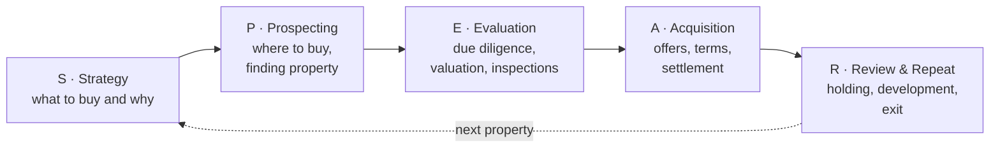

# Australian Property AI Skills · aus-property-skills

[中文](README.md) | **English**

The checks and calculations a buyer's agent actually uses, packaged as AI skills you can run on your own computer. One skill per step: before buying, choosing a suburb, due diligence, making an offer, settlement, holding, and selling.

**Made by** Shuai Luo, a Sydney buyer's agent (Avocado Wealth), YouTube [「澳洲罗帅Shuai」@shuailuo](https://www.youtube.com/@shuailuo). Each skill comes with a 10–20 minute video explaining how the step is done and the reasoning behind it.

> Have at least A$500K–1M in cash and planning to buy in Australia? If you'd like our team to run the process for you, [get in touch](https://avocadowealth.com.au/home-english?ref=aus-property-skills).

## The SPEAR buying system

We buy for clients using SPEAR, a five-step buying system. The skills here follow the same five steps.



## Skills

| SPEAR | Skill | What it does | Status | Video |
|---|---|---|---|---|
| E Evaluation | `auspptdd` | From one address: facts, hazards, planning, comparable sales, price range, red flags | 🔨 in verification | coming |
| R Review | `holiday-home` | Holiday home: buy or book, keep or sell, tax on mixed private and rental use | 🔨 in progress | coming |
| R Review | `hold-or-sell` | Check-up on a property you own: keep or sell, given purchase date, tax changes, loan and cash flow | 🗓 next batch | — |
| S Strategy | `family-funding` | Family help: gift, loan, guarantor or joint purchase — terms checklist and risks | 🗓 next batch | — |
| P Prospecting | `suburb-owner` / `suburb-investor` | Suburb selection for owner-occupiers / investors | 🗓 next batch | — |
| A Acquisition | `price-guide-offer` | Read the price guide, spot underquoting, set your opening offer and limit | 🗓 next batch | — |

The full plan of 57 skills, in journey order, is in [ROADMAP.md](ROADMAP.md). Skills ship one at a time.

## Install

You need a **coding agent that can run code and reach the internet**, such as Claude Code or Codex CLI. Web chat products (claude.ai, ChatGPT, Gemini) cannot run these skills — we tested: their sandboxes can't fetch official data.

**Option 1: one command**

```bash
npx skills add theshuailuo/aus-property-skills -a claude-code
```

To install one skill, add `--skill holiday-home`. Keep `-a claude-code`: when run inside an agent session without it, the command may install to a folder Claude Code doesn't read.

**Option 2: Claude Code plugin marketplace**

```
/plugin marketplace add theshuailuo/aus-property-skills
/plugin install aus-property-skills@aus-property-skills
```

**Option 3: copy by hand**

```bash
git clone https://github.com/theshuailuo/aus-property-skills.git
cp -r aus-property-skills/skills/holiday-home ~/.claude/skills/
```

On Windows PowerShell: `Copy-Item -Recurse aus-property-skills\skills\holiday-home $HOME\.claude\skills\`. Other agents: copy into the folder that agent reads skills from.

**Updating**: check [VERSIONS.md](VERSIONS.md) and reinstall any skill that is behind. Skills never go online to check for updates during your session.

## Using a skill

Just ask in English or Chinese, for example:

- "Do due diligence on 12 Example St, Newtown NSW 2042"
- "I saw a place in Mudgee — does buying it as a holiday home make sense?"

Reports follow the language you ask in. Only free official public data is used; anything that needs a paid subscription is left blank with the reason — no invented numbers.

**Buyer profile (optional)**: create `.agents/buyer-strategy.md` in your project with your budget, purpose, ownership structure and so on, and skills will tailor their advice; without it they give a neutral view. The file is git-ignored.

**Local extras (optional)**: a `private.local.md` inside a skill folder holds your own extra rules (for example, data sources you subscribe to). The skill reads it first. It is git-ignored too.

## Disclaimer

This is a tool we use in our own property purchases, provided for reference only. Everything here is general information and does not take your personal circumstances into account. For contracts, lending and tax, we recommend consulting a licensed professional; if you decide without professional review, you accept the consequences of that decision. Full wording by topic: [shared/disclaimers.md](shared/disclaimers.md).

## License & feedback

Code and method text are [MIT](LICENSE). Names, logos and handles such as "Avocado Wealth", 「澳洲罗帅」 and "SPEAR" are not covered by MIT — full list in [TRADEMARK.md](TRADEMARK.md).

Found a problem or want a scenario sooner? Tell us in [Issues](https://github.com/theshuailuo/aus-property-skills/issues) or in the video comments. To contribute, read [CONTRIBUTING.md](CONTRIBUTING.md).
