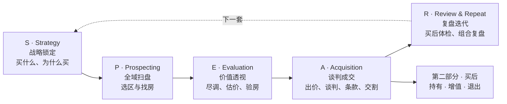

# 澳洲买房 AI 技能库 · aus-property-skills

**中文** | [English](README.en.md)

把买家代理买房时真正在用的查法和算法,做成你在自己电脑上就能跑的 AI skill。从想买之前,到选区、尽调、出价、交割、持有、卖房,每一步一个。

**出品人**:罗帅 Shuai Luo,悉尼买家代理,YouTube [「澳洲罗帅Shuai」@shuailuo](https://www.youtube.com/@shuailuo)。每个 skill 配一条 10–20 分钟的视频,讲清楚这一步怎么做、背后是什么逻辑。

> **用这些 skill 查完了,还是拿不准要不要出手?** 手里有 50 万澳元以上现金、准备买投资房的买家,可以预约罗帅团队 30 分钟 1 对 1 免费购房策略体检,把报告里「还要人去做」的那几步交给我们。每周只开放 5 个名额。[立即预约](https://avocadowealth.com.au/free-consultation-team?ref=aus-property-skills)<br><sub>买家代理服务由 Avocado Wealth 提供(NSW 持牌,牌照号 10109450)。</sub>

## 买房流程:SPEAR 五步

我们帮客户买房用的是 SPEAR 买房执行系统,第一部分的 skill 按这五步排;买到之后的持有、增值、退出放在第二部分。



## Skill 一览

| 位置 | skill | 做什么 | 状态 | 视频 |
|---|---|---|---|---|
| E 价值透视 | `auspptdd` | 给一个地址(独立屋或公寓),跑出事实、灾害、规划、可比成交、价格区间、红旗清单 | ✅ v0.4.2(NSW、WA 各冷跑过独立屋与公寓) | 待上线 |
| 买后 · 持有 | `holiday-home` | 度假屋:买还是订、留还是卖、自用加出租的税务 | 🔨 在做 | 待上线 |
| P 全域扫盘 | `suburb-owner` / `suburb-investor` | 自住选区 / 投资选区 | 🗓 第一批 | — |
| R 复盘迭代 | `hold-or-sell` | 持有房体检:按购入日期、税改、贷款与现金流看留还是卖 | 🗓 第一批 | — |
| S 战略锁定 | `family-funding` | 家庭资助:赠与、借款、担保人、联名的条款清单与风险 | 🗓 第一批 | — |
| A 谈判成交 | `price-guide-offer` | 读价格指引、判断 underquoting、定开价与上限 | 🗓 第一批 | — |

全部 57 个按流程排好的计划见 [ROADMAP.md](ROADMAP.md)。做一个发一个。

## 安装

需要一个**能运行代码、能联网的编程 agent**,例如 Claude Code、Codex CLI。claude.ai、ChatGPT、Gemini 的网页聊天跑不了这些 skill(我们实测过:网页沙箱不能联网取官方数据)。

**方式一:一行命令**

```bash
npx skills add theshuailuo/aus-property-skills -a claude-code
```

只装一个:在后面加 `--skill holiday-home`。`-a claude-code` 别省:在 agent 会话里运行这条命令时,不加它可能装到 Claude Code 读不到的目录。

**方式二:Claude Code 插件市场**

```
/plugin marketplace add theshuailuo/aus-property-skills
/plugin install aus-property-skills@aus-property-skills
```

**方式三:手工复制**

```bash
git clone https://github.com/theshuailuo/aus-property-skills.git
cp -r aus-property-skills/skills/holiday-home ~/.claude/skills/
```

Windows PowerShell 用 `Copy-Item -Recurse aus-property-skills\skills\holiday-home $HOME\.claude\skills\`。其他 agent:放到它读取 skill 的目录。

**更新**:看 [VERSIONS.md](VERSIONS.md),本机版本旧了就重新安装。skill 不会在你的会话里自己联网检查更新。

## 怎么用

装好后在 agent 里直接说中文或英文,例如:

- 「尽调这个地址:12 Example St, Newtown NSW 2042」
- 「我在 Mudgee 看到一套房,买来度假划不划算?」

报告语言跟随你提问的语言。只用免费的官方公开数据;需要付费订阅才有的数据,报告里留空并写明原因,不编数字。

**买家档案(可选)**:在你的项目里建 `.agents/buyer-strategy.md`,写上预算、用途、名下结构等,skill 会结合它给意见;没有它,skill 给中立看法。这个文件已被 `.gitignore` 忽略,不会被提交。

**本机加料(可选)**:在某个 skill 目录里建 `private.local.md`,写你自己的额外规则(比如你有订阅的数据源)。skill 会先读它。它同样被忽略,不会被提交。

## 免责

这是我们自己买房时会用的工具,仅供参考。本仓库内容是一般信息,未结合您的个人情况。涉及合同、贷款、税务,建议您咨询持牌专业人士;如您未经专业人士审阅自行决定,相关后果由您自行承担。各领域完整措辞见 [shared/disclaimers.md](shared/disclaimers.md)。

## 许可与反馈

代码和方法正文按 [MIT](LICENSE) 开放;「Avocado Wealth」「澳洲罗帅」「SPEAR」等名称、标志和账号不在 MIT 范围内,完整清单见 [TRADEMARK.md](TRADEMARK.md)。

发现问题、想要某个场景先做,在 [Issues](https://github.com/theshuailuo/aus-property-skills/issues) 或视频评论区说。想参与改进,先读 [CONTRIBUTING.md](CONTRIBUTING.md)。
